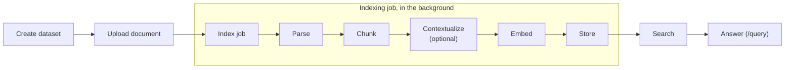

# How RAG works in rag-service

This document follows one document through the service, from dataset creation to an answer with citations. It describes what happens and where in the code, with an example at every step. For the REST API itself, see [API.md](API.md).



Indexing (step 3) runs in the background. Search and answering (steps 4 and 5) run inside the request.

All model calls go through the LiteLLM proxy at `LITELLM_BASE_URL` (server configuration). They use the caller's `X-Model-API-Key`, which is never stored.

**The running example.** Every step uses the same document: `sla.pdf`, the two-page test PDF in [tests/fixtures/table.pdf](tests/fixtures/table.pdf). Page 1 has a title, a "1. Scope" section, and a "2. Price Table" section with a three-row table. Page 2 has "3. Termination" and "4. Support". It goes into a dataset that uses `titan-embed-v2` for embeddings and `claude-haiku-5-5` for contextual retrieval.

The requests, file layouts, chunk texts, model requests, and prompts below are what the code produces for this document; they were recorded by running it against mocked parsers and a mocked LiteLLM. Values that come from the models (contexts, scores, answers, token counts) are illustrative, and ids are shortened to the ones used in API.md.

```bash
B=http://localhost:8000/v1
KEY=sk-...   # LiteLLM key
```

---

## 1. Create a dataset

`POST /v1/datasets` · `api/datasets.py`

A dataset is the unit of access control and fixes the settings every document in it shares:

- **Embedding model**: a LiteLLM model name, or the development-only `hash` provider. The service embeds a short text once to measure the model's output dimension. Models with more than 2000 dimensions are rejected, because that is pgvector's HNSW limit.
- **Chunking**: `chunk_size` (tokens, default 512) and `chunk_overlap` (default 64).
- **Contextual retrieval** (optional): a LiteLLM chat model, checked once with a 1-token call.

The service then creates the dataset's own vector table, `vectors.data_ds_{dataset_id}`, with an HNSW cosine index. None of these settings can change later.

### Example

```bash
curl -s -X POST $B/datasets -H 'content-type: application/json' -H "X-Model-API-Key: $KEY" -d '{
  "name": "contracts",
  "embedding": {"provider": "litellm", "model": "titan-embed-v2"},
  "contextual": {"model": "claude-haiku-5-5"}
}'
```

Before answering, the service makes two calls to LiteLLM with the caller's key:

```jsonc
// POST {LITELLM_BASE_URL}/embeddings: measures the dimension (1024 for Titan V2)
{"model": "titan-embed-v2", "input": ["dimension probe"], "encoding_format": "base64"}

// POST {LITELLM_BASE_URL}/chat/completions: checks the contextual model
{"model": "claude-haiku-5-5", "max_tokens": 1, "messages": [{"role": "user", "content": "Reply with OK."}]}
```

Then it creates the table `vectors.data_ds_52967db904d44a09b33f88b3c9f64a6a` with 1024-dimension vectors, and returns:

```json
{
  "id": "52967db904d44a09b33f88b3c9f64a6a",
  "name": "contracts",
  "embedding": {"provider": "litellm", "model": "titan-embed-v2", "dim": 1024, "dimensions": null, "input_type": null},
  "chunk_size": 512,
  "chunk_overlap": 64,
  "contextual": {"model": "claude-haiku-5-5"},
  "metadata": {},
  "document_counts": {"total": 0},
  ...
}
```

## 2. Upload a document

`POST /v1/datasets/{id}/documents` · `api/documents.py`, `storage/blob.py`

1. The file is streamed to `tmp/`, and the size limit (`MAX_UPLOAD_MB`, 100) is enforced while its sha256 is computed.
2. If the dataset already has a file with the same sha256, the upload is rejected as a duplicate.
3. The file moves to `originals/{dataset_id}/{document_id}{ext}`, and a `documents` row is created with status `uploaded`.
4. With `index=true`, an indexing job is created right away (step 3).

### Example

```bash
curl -s -X POST $B/datasets/52967db904d44a09b33f88b3c9f64a6a/documents -H "X-Model-API-Key: $KEY" \
  -F file=@sla.pdf -F index=true -F parser=docling -F 'metadata={"year": 2025}'
```

The file is stored as `{DATA_DIR}/originals/52967db904d44a09b33f88b3c9f64a6a/bbd713912b614848a8f0def3f73aa304.pdf`. The response has the document and its new job:

```json
{
  "document": {
    "id": "bbd713912b614848a8f0def3f73aa304",
    "filename": "sla.pdf",
    "mime_type": "application/pdf",
    "size_bytes": 3661,
    "sha256": "b9026a559834239c2b981d65727c063dfacb0f28a4e68070d6e606609917d9d1",
    "status": "uploaded",
    "num_chunks": null,
    "metadata": {"year": 2025},
    ...
  },
  "job": {"id": "2d18380d5e6548ed868383387a606e3b", "parser": "docling", "options": {}, "status": "queued", "stage": null, "progress": 0.0, ...}
}
```

Uploading the same bytes again, even under another name, returns `409`:

```json
{"error": {"code": "duplicate_document", "message": "identical file already exists as document 'bbd713912b614848a8f0def3f73aa304'"}}
```

## 3. Index the document

Indexing runs in the background as a job, in five stages: parse, chunk, contextualize (optional), embed, and store. The job reports the stage it is in as `stage` and its overall progress from 0.0 to 1.0 as `progress`.

### 3.1 Start the job

`POST .../documents/{id}/index`, `POST .../index` (bulk), or upload with `index=true` · `services/jobs.py`, `jobs/runner.py`

1. The parser is resolved. `.md`, `.markdown`, and `.txt` files always use `passthrough`. Other files use the requested `docling` or `mineru`, and the parser's options are validated. For MinerU, the effective `tier` is always recorded in the options.
2. The parser service must be reachable, and the key must be present if the dataset needs one (LiteLLM embedding or contextual retrieval).
3. An `index_jobs` row is created with status `queued`. A document can have only one active job.
4. The job id goes onto an in-process `asyncio.Queue`, served by `JOB_WORKERS` (4) workers. The caller's key is held in memory next to the job id until the job ends.

From here the job runs `IndexingPipeline.run` (`services/indexing.py`). It updates `stage` and `progress` as it goes, and the document's status becomes `indexing`.

#### Example

A job starts in one of three ways. The upload in step 2 used the first one: `index=true` created job `2d18380d…` along with the document.

If the document had been uploaded without `index=true`, or to index it again later, start a job for that one document:

```bash
curl -s -X POST $B/datasets/52967db904d44a09b33f88b3c9f64a6a/documents/bbd713912b614848a8f0def3f73aa304/index \
  -H 'content-type: application/json' -H "X-Model-API-Key: $KEY" \
  -d '{"parser": "docling", "options": {"do_ocr": false}}'
```

`202 Accepted`, with the new job:

```json
{
  "id": "2d18380d5e6548ed868383387a606e3b",
  "dataset_id": "52967db904d44a09b33f88b3c9f64a6a",
  "document_id": "bbd713912b614848a8f0def3f73aa304",
  "parser": "docling",
  "options": {"do_ocr": false},
  "force_reparse": false,
  "status": "queued",
  "stage": null,
  "progress": 0.0,
  "error": null,
  "created_at": "2026-11-05T18:59:10.800578Z",
  "started_at": null,
  "finished_at": null
}
```

To start jobs for every document in the dataset that is not indexed yet (status `uploaded` or `failed`):

```bash
curl -s -X POST $B/datasets/52967db904d44a09b33f88b3c9f64a6a/index \
  -H 'content-type: application/json' -H "X-Model-API-Key: $KEY" \
  -d '{"parser": "docling", "scope": "unindexed"}'
```

`202 Accepted`, with one job per document and the documents that were left out:

```json
{
  "jobs": [{"id": "2d18380d5e6548ed868383387a606e3b", "document_id": "bbd713912b614848a8f0def3f73aa304", "parser": "docling", "status": "queued", ...}],
  "skipped": []
}
```

`"scope": "all"` re-indexes every document instead. A request for a document whose job is still queued or running is refused:

```json
{"error": {"code": "job_in_progress", "message": "document 'bbd713912b614848a8f0def3f73aa304' already has an active indexing job"}}
```

Polling `GET $B/datasets/52967db9.../jobs/2d18380d...` while the job runs shows it moving through the stages (only `status`, `stage`, and `progress` shown):

```
{"status": "queued",    "stage": null,              "progress": 0.0}
{"status": "running",   "stage": "parsing",         "progress": 0.0}
{"status": "running",   "stage": "chunking",        "progress": 0.4}
{"status": "running",   "stage": "contextualizing", "progress": 0.45}  … rises to 0.7
{"status": "running",   "stage": "embedding",       "progress": 0.7}   … rises to 0.9
{"status": "running",   "stage": "storing",         "progress": 0.9}
{"status": "succeeded", "stage": "storing",         "progress": 1.0}
```

The same document with MinerU would record its tier in the job: `{"parser": "mineru", "options": {"tier": "basic"}}`.

### 3.2 Parse

Stage `parsing`, progress 0–0.4 · `parsers/`

The parse cache is checked first. Its key is the parser name plus a hash of the options, so a job with the same parser and options reuses the earlier result unless `force_reparse` is set. Otherwise the file goes to the parser, limited by a per-parser concurrency semaphore:

| Parser | How | Result |
|--------|-----|--------|
| `passthrough` | Reads the file as text (UTF-8, then CP949). | Markdown only. |
| `docling` | docling-serve over HTTP: submit an async task, poll, fetch the result. | Markdown with page breaks, plus the DoclingDocument JSON (headings, paragraphs, lists, tables with cell grids, pages). |
| `mineru` | mineru-api over HTTP: create a task, upload the file, poll, download a zip. | Markdown, plus `structured_content.json` (typed blocks per page: titles, text, tables, images, ...). |

The result is cached under `parsed/{dataset_id}/{document_id}/{cache_key}/`: `content.md`, `pages.json` with each page's character range in the markdown, `meta.json`, and `raw.json` with the parser's structured output.

#### Example

Docling with no options gives the cache key `docling-44136fa355b3` (MinerU with the default options would be `mineru-0c86fad31a12`). The cache directory:

```
parsed/52967db904d44a09b33f88b3c9f64a6a/bbd713912b614848a8f0def3f73aa304/docling-44136fa355b3/
├── content.md
├── pages.json   [{"page": 1, "start": 0, "end": 479}, {"page": 2, "start": 481, "end": 711}]
├── meta.json    {"parser": "docling", "status": "success", "errors": [], "processing_time": 1.08, "confidence": "good"}
└── raw.json     the DoclingDocument
```

`content.md`, with Docling's page break already removed:

```markdown
## Service Level Agreement

## 1. Scope

This agreement covers the cloud storage service provided to the customer. It applies to all regions listed in the price table below.

## 2. Price Table

Table 1. Monthly prices by region.

| Region   | Storage per GB   | Egress per GB   |
|----------|------------------|-----------------|
| us-east  | 0.023 USD        | 0.09 USD        |
...
```

`raw.json` holds the same content as typed items with their pages. Two of them, shortened:

```jsonc
// texts[3]
{"label": "section_header", "level": 1, "text": "2. Price Table", "prov": [{"page_no": 1, ...}]}
// tables[0]: a 4 × 3 cell grid; the first row is marked as the column header
{"label": "table", "captions": [{"$ref": "#/texts/4"}], "prov": [{"page_no": 1, ...}],
 "data": {"num_rows": 4, "num_cols": 3,
          "grid": [[{"text": "Region", "column_header": true}, ...], [{"text": "us-east", ...}, ...], ...]}}
```

### 3.3 Chunk

Stage `chunking`, progress 0.4–0.45 · `services/chunking.py`

How the document is chunked depends on whether the parser left a structure behind.

**Structure (Docling, MinerU).** The structured output is turned into blocks in reading order: headings, paragraphs, list items, and tables, each with its page. Page headers, footers, and page numbers are dropped. Then:

- A heading starts a new chunk, and the current heading path becomes the chunk's `section_path`. A heading with no text before the next heading, such as a document title, is carried into the next chunk.
- Following blocks are packed into the chunk while it stays within `chunk_size` tokens. Blocks are never cut.
- A table is a chunk of its own, together with its caption and footnotes. A table larger than `chunk_size` is split between rows, and each piece repeats the header row and the caption.
- A single block larger than `chunk_size` is split by sentence, with `chunk_overlap`.
- `page` is the page of the chunk's first block.

**Markdown (passthrough, or no usable structure).** The markdown is split into heading sections, and sections larger than `chunk_size` are split by sentence with `chunk_overlap`. A chunk's page comes from its position in the markdown and `pages.json`.

Tokens are counted with the tiktoken `cl100k_base` tokenizer bundled with LlamaIndex. Sentences are split with a regex that handles Korean and CJK punctuation.

#### Example

`raw.json` becomes ten blocks:

| # | Kind | Page | Text |
|---|------|------|------|
| 1 | heading (level 2) | 1 | Service Level Agreement |
| 2 | heading (level 2) | 1 | 1. Scope |
| 3 | text | 1 | This agreement covers the cloud storage service … |
| 4 | heading (level 2) | 1 | 2. Price Table |
| 5 | table | 1 | caption "Table 1. Monthly prices by region." + 3 rows |
| 6 | heading (level 2) | 2 | 3. Termination |
| 7 | text | 2 | Either party may terminate the agreement … |
| 8 | heading (level 2) | 2 | 4. Support |
| 9 | text | 2 | - Email support on business days. |
| 10 | text | 2 | - Phone support for enterprise plans. |

With `chunk_size` 512 they become four chunks. Block 1 has no text of its own, so it is carried into chunk 0, and the table gets its own chunk:

| `chunk_index` | `page` | `section_path` | Blocks |
|---|---|---|---|
| 0 | 1 | `["1. Scope"]` | 1, 2, 3 |
| 1 | 1 | `["2. Price Table"]` | 4, 5 |
| 2 | 2 | `["3. Termination"]` | 6, 7 |
| 3 | 2 | `["4. Support"]` | 8, 9, 10 |

The text of chunk 1:

```markdown
## 2. Price Table

Table 1. Monthly prices by region.

| Region | Storage per GB | Egress per GB |
| --- | --- | --- |
| us-east | 0.023 USD | 0.09 USD |
| eu-west | 0.025 USD | 0.10 USD |
| ap-north | 0.027 USD | 0.12 USD |
```

If the table had too many rows for `chunk_size`, it would be split into several chunks, each starting with the caption and the `| Region | Storage per GB | Egress per GB |` header.

### 3.4 Contextualize (optional)

Stage `contextualizing`, progress 0.45–0.7, only for datasets with `contextual` · `services/contextual.py`

A chunk often makes sense only within its document. For each chunk, the dataset's chat model gets the whole document and the chunk, and writes a short context, about 50–100 tokens, that situates the chunk in the document.

- The document is sent as a separate content block marked with `cache_control`. With models that support prompt caching, every call after the first reads it from the cache.
- The first chunk is sent alone so it writes the cache. The rest follow with up to `CONTEXTUAL_CONCURRENCY` (4) calls at once.
- Documents over `CONTEXTUAL_DOCUMENT_TOKENS` (100,000) are sent in consecutive parts, and each chunk is situated within its own part.
- If any call fails, the job fails, so a dataset never mixes chunks with and without contexts.

#### Example

Four calls, one per chunk. The call for chunk 1, with the document shortened:

```jsonc
// POST {LITELLM_BASE_URL}/chat/completions
{
  "model": "claude-haiku-5-5",
  "max_tokens": 200,
  "temperature": 0.0,
  "messages": [{
    "role": "user",
    "content": [
      {"type": "text",
       "text": "<document>\n## Service Level Agreement\n\n## 1. Scope\n\n… the whole document …\n\n- Phone support for enterprise plans.\n</document>",
       "cache_control": {"type": "ephemeral"}},
      {"type": "text",
       "text": "Here is the chunk we want to situate within the whole document\n<chunk>\n## 2. Price Table\n\nTable 1. Monthly prices by region.\n\n| Region | … |\n</chunk>\nPlease give a short succinct context to situate this chunk within the overall document for the purposes of improving search retrieval of the chunk. Write it in the language of the document. Answer only with the succinct context and nothing else."}
    ]
  }]
}
```

The first content block is identical in all four calls, which is what lets the provider cache it. The model answers with something like:

```
This chunk is the price table of the cloud storage Service Level Agreement, listing monthly storage and egress prices per GB for the us-east, eu-west, and ap-north regions.
```

When the job ends, a log line reports the calls and tokens, for example `4 contexts with claude-haiku-5-5; input 1120 tokens (0 cached), output 140`. Nothing is cached in this example: providers cache a prompt only above a model-specific minimum length, and this document is about 170 tokens. For a long document, every call after the first reports most of its input as cached.

### 3.5 Embed

Stage `embedding`, progress up to 0.9 · `providers/embeddings.py`

Each chunk is embedded from this text:

```
{section path joined with " > "}

{context, if contextual retrieval is on}

{chunk text}
```

Chunks are sent in batches of `EMBED_BATCH_SIZE` (64) to the dataset's model, with the `document` input type for asymmetric models such as Cohere. Every vector must have the dataset's dimension.

#### Example

All four chunks fit in one batch. LlamaIndex's OpenAI-compatible client replaces newlines with spaces before sending, so the request looks like this (texts shortened):

```jsonc
// POST {LITELLM_BASE_URL}/embeddings
{
  "model": "titan-embed-v2",
  "encoding_format": "base64",
  "input": [
    "1. Scope  This chunk is the scope section …  ## Service Level Agreement  ## 1. Scope  This agreement covers …",
    "2. Price Table  This chunk is the price table …  ## 2. Price Table  Table 1. Monthly prices by region.  | Region | Storage per GB | Egress per GB | | --- | --- | --- | | us-east | 0.023 USD | 0.09 USD | …",
    "3. Termination  This chunk is the termination clause …  ## 3. Termination  Either party may terminate …",
    "4. Support  This chunk lists the support channels …  ## 4. Support  - Email support on business days. …"
  ]
}
```

The response has four 1024-dimension vectors, one per input, in the same order.

### 3.6 Store

Stage `storing`, progress up to 1.0 · `storage/vector.py`

1. Each chunk becomes a node in the dataset's vector table: the text, the vector, and metadata. The metadata holds the document's own metadata plus `filename`, `parser`, `page`, `section_path`, `chunk_index`, `job_id`, and `context` when there is one.
2. The document's nodes from earlier jobs are deleted. Because new nodes are written before old ones are removed, re-indexing never leaves a gap in search.
3. The job becomes `succeeded`, and the document becomes `indexed` with `num_chunks`.

If the job fails or is canceled at any point, only its own nodes are removed. A document that was indexed before keeps its previous chunks and stays `indexed`. If the server restarts, queued and running jobs have lost their key, so they are marked `failed` with "interrupted" and must be resubmitted.

#### Example

The row for chunk 1 in `vectors.data_ds_52967db904d44a09b33f88b3c9f64a6a`:

| Column | Value |
|--------|-------|
| `text` | The chunk text from step 3.3 (without the section path or context). |
| `embedding` | The 1024-dimension vector from step 3.5. |
| `metadata_` | Shown below. |

```json
{
  "year": 2025,
  "filename": "sla.pdf",
  "parser": "docling",
  "page": 1,
  "section_path": ["2. Price Table"],
  "chunk_index": 1,
  "job_id": "2d18380d5e6548ed868383387a606e3b",
  "context": "This chunk is the price table of the cloud storage Service Level Agreement, …",
  "ref_doc_id": "bbd713912b614848a8f0def3f73aa304",
  "document_id": "bbd713912b614848a8f0def3f73aa304",
  "doc_id": "bbd713912b614848a8f0def3f73aa304",
  "_node_type": "TextNode",
  "_node_content": "…"
}
```

`year` comes from the document's metadata. `ref_doc_id`, `document_id`, `doc_id`, `_node_type`, and `_node_content` are LlamaIndex's own bookkeeping; `ref_doc_id` is what deletes and document filters use.

The document afterwards:

```json
{"id": "bbd713912b614848a8f0def3f73aa304", "status": "indexed", "parser": "docling", "num_chunks": 4, "indexed_at": "2026-11-05T18:59:10.988286Z", ...}
```

Re-indexing it later writes four new rows with the new job's `job_id`, then deletes these four.

## 4. Search

`POST /v1/datasets/{id}/search` · `services/retrieval.py`

1. The request is validated: `top_k` must be at most `MAX_TOP_K` (50), and metadata filter keys must be well formed.
2. The query is embedded with the dataset's model, with the `query` input type for asymmetric models.
3. pgvector returns the `top_k` nodes closest by cosine similarity, using the HNSW index. Filters on document ids or metadata (JSONB containment) are applied in the same SQL query with bound parameters.
4. Results are joined with the current document rows. This drops vectors of documents deleted in the meantime and returns the document's current filename and metadata.

Each result carries the chunk's `text`, `score`, `page`, `section_path`, `chunk_index`, and `context`.

### Example

```bash
curl -s -X POST $B/datasets/52967db904d44a09b33f88b3c9f64a6a/search \
  -H 'content-type: application/json' -H "X-Model-API-Key: $KEY" \
  -d '{"query": "How much does egress cost in eu-west?", "top_k": 2, "filters": {"metadata": {"year": 2025}}}'
```

The query is embedded with one call, `{"model": "titan-embed-v2", "input": ["How much does egress cost in eu-west?"], ...}`. The `year` filter keeps only chunks whose metadata contains `{"year": 2025}`. The table chunk ranks first: its context and table both mention egress and eu-west.

```json
{
  "query": "How much does egress cost in eu-west?",
  "results": [
    {
      "score": 0.71,
      "text": "## 2. Price Table\n\nTable 1. Monthly prices by region.\n\n| Region | Storage per GB | Egress per GB |\n| --- | --- | --- |\n| us-east | 0.023 USD | 0.09 USD |\n| eu-west | 0.025 USD | 0.10 USD |\n| ap-north | 0.027 USD | 0.12 USD |",
      "document_id": "bbd713912b614848a8f0def3f73aa304",
      "filename": "sla.pdf",
      "page": 1,
      "section_path": ["2. Price Table"],
      "chunk_index": 1,
      "context": "This chunk is the price table of the cloud storage Service Level Agreement, listing monthly storage and egress prices per GB for the us-east, eu-west, and ap-north regions.",
      "metadata": {"year": 2025}
    },
    {
      "score": 0.48,
      "text": "## Service Level Agreement\n\n## 1. Scope\n\nThis agreement covers the cloud storage service provided to the customer. It applies to all regions listed in the price table below.",
      "document_id": "bbd713912b614848a8f0def3f73aa304",
      "filename": "sla.pdf",
      "page": 1,
      "section_path": ["1. Scope"],
      "chunk_index": 0,
      "context": "This chunk is the scope section of the Service Level Agreement for the cloud storage service, which applies to all regions in the price table.",
      "metadata": {"year": 2025}
    }
  ]
}
```

## 5. Answer

`POST /v1/datasets/{id}/query` · `api/search.py`, `services/answering.py`

1. **Retrieve** exactly as in step 4.
2. **Fit the source budget.** Sources are taken best first while their prompt blocks fit within `max_source_tokens` (default `QUERY_SOURCE_TOKENS`, 16,000). The best source is always kept. The rest are dropped and counted in `sources_dropped`. The kept sources are numbered `[1]` to `[n]`.
3. **Build the prompt.**
   - System prompt: answer only from the numbered sources, cite them as `[n]` after each statement, say so when the sources do not contain the answer, and answer in the question's language.
   - User message: each source as `[n] (filename, page, section path)` followed by its text, then the question.
4. **Call the LLM** named in the request's `model`. The name is passed to LiteLLM as-is, with `max_output_tokens` (default 1024) and temperature 0.1.
5. **Return the answer.**
   - JSON: `answer`, `citations` (the source numbers that appear in the answer, in order of first use), `sources`, `sources_dropped`, and `usage`.
   - With `stream: true`, Server-Sent Events: `sources` first, then `delta` events as the LLM writes, then `done` with the citations and usage, or `error`. The first chunk from the LLM is read before the response starts, so a bad key or unknown model is still a normal HTTP error.

If nothing is retrieved, the LLM is not called and `answer` is `null`.

### Example

```bash
curl -s -X POST $B/datasets/52967db904d44a09b33f88b3c9f64a6a/query \
  -H 'content-type: application/json' -H "X-Model-API-Key: $KEY" \
  -d '{"query": "How much does egress cost in eu-west?", "model": "claude-sonnet-5-5", "top_k": 2}'
```

The same two chunks as in step 4 are retrieved. Together they are far below the 16,000-token budget, so both are kept as sources `[1]` and `[2]`. The LLM receives two messages.

System:

```
You answer questions using only the numbered sources provided by the user.
Rules:
- Base every statement on the sources. Do not use outside knowledge.
- Cite the sources that support each statement with bracketed numbers right after it, e.g. [1] or [2][3].
- If the sources do not contain the answer, say that the documents do not contain it. Do not guess.
- Answer in the same language as the question.
- Be concise.
```

User:

```
Sources:

[1] (sla.pdf, page 1, 2. Price Table)
## 2. Price Table

Table 1. Monthly prices by region.

| Region | Storage per GB | Egress per GB |
| --- | --- | --- |
| us-east | 0.023 USD | 0.09 USD |
| eu-west | 0.025 USD | 0.10 USD |
| ap-north | 0.027 USD | 0.12 USD |

[2] (sla.pdf, page 1, 1. Scope)
## Service Level Agreement

## 1. Scope

This agreement covers the cloud storage service provided to the customer. It applies to all regions listed in the price table below.

Question: How much does egress cost in eu-west?
```

The contexts are not part of the prompt; they only help retrieval. The response:

```json
{
  "query": "How much does egress cost in eu-west?",
  "answer": "Egress in eu-west costs 0.10 USD per GB [1].",
  "model": "claude-sonnet-5-5",
  "citations": [1],
  "sources": [
    {"id": 1, "score": 0.71, "text": "## 2. Price Table\n\n…", "filename": "sla.pdf", "page": 1, "section_path": ["2. Price Table"], "chunk_index": 1, ...},
    {"id": 2, "score": 0.48, "text": "## Service Level Agreement\n\n…", "filename": "sla.pdf", "page": 1, "section_path": ["1. Scope"], "chunk_index": 0, ...}
  ],
  "sources_dropped": 0,
  "usage": {"input_tokens": 248, "output_tokens": 17}
}
```

`citations` is `[1]` because only `[1]` appears in the answer, so a client can show "sla.pdf, page 1, 2. Price Table" next to it.

With `"stream": true`, the same request returns Server-Sent Events:

```
event: sources
data: {"query": "How much does egress cost in eu-west?", "sources": [{"id": 1, ...}, {"id": 2, ...}], "sources_dropped": 0}

event: delta
data: {"text": "Egress in eu-west costs"}

event: delta
data: {"text": " 0.10 USD per GB [1]."}

event: done
data: {"answer": "Egress in eu-west costs 0.10 USD per GB [1].", "model": "claude-sonnet-5-5", "citations": [1], "usage": {"input_tokens": 248, "output_tokens": 17}}
```

With `"top_k": 4, "max_source_tokens": 120`, only the table chunk would fit: its source block, with the `[1] (…)` header, is about 100 tokens, and every other chunk is at least 36. It would be sent alone, and the response would have `"sources_dropped": 3`.

A question the documents cannot answer, such as "Is there a free tier?", still retrieves the closest chunks, but the system prompt makes the LLM say the documents do not contain the answer instead of guessing.
