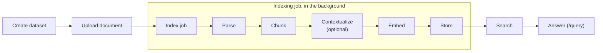

# How RAG works in rag-service

This document follows one document through the service, from dataset creation to an answer with citations. It describes what happens and where in the code. For the REST API itself, see [API.md](API.md).



Indexing (steps 3–8) runs in the background. Search and answering (steps 9–10) run inside the request.

All model calls go through the LiteLLM proxy at `LITELLM_BASE_URL` (server configuration). They use the caller's `X-Model-API-Key`, which is never stored.

---

## 1. Create a dataset

`POST /v1/datasets` · `api/datasets.py`

A dataset is the unit of access control and fixes the settings every document in it shares:

- **Embedding model**: a LiteLLM model name, or the development-only `hash` provider. The service embeds a short text once to measure the model's output dimension. Models with more than 2000 dimensions are rejected, because that is pgvector's HNSW limit.
- **Chunking**: `chunk_size` (tokens, default 512) and `chunk_overlap` (default 64).
- **Contextual retrieval** (optional): a LiteLLM chat model, checked once with a 1-token call.

The service then creates the dataset's own vector table, `vectors.data_ds_{dataset_id}`, with an HNSW cosine index. None of these settings can change later.

## 2. Upload a document

`POST /v1/datasets/{id}/documents` · `api/documents.py`, `storage/blob.py`

1. The file is streamed to `tmp/`, and the size limit (`MAX_UPLOAD_MB`, 100) is enforced while its sha256 is computed.
2. If the dataset already has a file with the same sha256, the upload is rejected as a duplicate.
3. The file moves to `originals/{dataset_id}/{document_id}{ext}`, and a `documents` row is created with status `uploaded`.
4. With `index=true`, an indexing job is created right away (step 3).

## 3. Start an indexing job

`POST .../documents/{id}/index`, `POST .../index` (bulk), or upload with `index=true` · `services/jobs.py`, `jobs/runner.py`

1. The parser is resolved. `.md`, `.markdown`, and `.txt` files always use `passthrough`. Other files use the requested `docling` or `mineru`, and the parser's options are validated. For MinerU, the effective `tier` is always recorded in the options.
2. The parser service must be reachable, and the key must be present if the dataset needs one (LiteLLM embedding or contextual retrieval).
3. An `index_jobs` row is created with status `queued`. A document can have only one active job.
4. The job id goes onto an in-process `asyncio.Queue`, served by `JOB_WORKERS` (4) workers. The caller's key is held in memory next to the job id until the job ends.

From here the job runs `IndexingPipeline.run` (`services/indexing.py`). It updates `stage` and `progress` as it goes, and the document's status becomes `indexing`.

## 4. Parse

Stage `parsing`, progress 0–0.4 · `parsers/`

The parse cache is checked first. Its key is the parser name plus a hash of the options, so a job with the same parser and options reuses the earlier result unless `force_reparse` is set. Otherwise the file goes to the parser, limited by a per-parser concurrency semaphore:

| Parser | How | Result |
|--------|-----|--------|
| `passthrough` | Reads the file as text (UTF-8, then CP949). | Markdown only. |
| `docling` | docling-serve over HTTP: submit an async task, poll, fetch the result. | Markdown with page breaks, plus the DoclingDocument JSON (headings, paragraphs, lists, tables with cell grids, pages). |
| `mineru` | mineru-api over HTTP: create a task, upload the file, poll, download a zip. | Markdown, plus `structured_content.json` (typed blocks per page: titles, text, tables, images, ...). |

The result is cached under `parsed/{dataset_id}/{document_id}/{cache_key}/`: `content.md`, `pages.json` with each page's character range in the markdown, `meta.json`, and `raw.json` with the parser's structured output.

## 5. Chunk

Stage `chunking`, progress 0.4–0.45 · `services/chunking.py`

How the document is chunked depends on whether the parser left a structure behind.

**Structure (Docling, MinerU).** The structured output is turned into blocks in reading order: headings, paragraphs, list items, and tables, each with its page. Page headers, footers, and page numbers are dropped. Then:

- A heading starts a new chunk, and the current heading path becomes the chunk's `section_path`. A heading with no text before the next heading, such as a document title, is carried into the next chunk.
- Following blocks are packed into the chunk while it stays within `chunk_size` tokens. Blocks are never cut.
- A table is a chunk of its own, together with its caption and footnotes. A table larger than `chunk_size` is split between rows, and each piece repeats the header row and the caption.
- A single block larger than `chunk_size` is split by sentence, with `chunk_overlap`.
- `page` is the page of the chunk's first block.

**Markdown (passthrough, or no usable structure).** The markdown is split into heading sections, and sections larger than `chunk_size` are split by sentence with `chunk_overlap`. A chunk's page comes from its position in the markdown and `pages.json`.

Tokens are counted with the tiktoken `cl100k_base` tokenizer bundled with LlamaIndex. Sentences are split with a regex that handles Korean and CJK punctuation.

## 6. Contextualize (optional)

Stage `contextualizing`, progress 0.45–0.7, only for datasets with `contextual` · `services/contextual.py`

A chunk often makes sense only within its document. For each chunk, the dataset's chat model gets the whole document and the chunk, and writes a short context, about 50–100 tokens, that situates the chunk in the document.

- The document is sent as a separate content block marked with `cache_control`. With models that support prompt caching, every call after the first reads it from the cache.
- The first chunk is sent alone so it writes the cache. The rest follow with up to `CONTEXTUAL_CONCURRENCY` (4) calls at once.
- Documents over `CONTEXTUAL_DOCUMENT_TOKENS` (100,000) are sent in consecutive parts, and each chunk is situated within its own part.
- If any call fails, the job fails, so a dataset never mixes chunks with and without contexts.

## 7. Embed

Stage `embedding`, progress up to 0.9 · `providers/embeddings.py`

Each chunk is embedded from this text:

```
{section path joined with " > "}

{context, if contextual retrieval is on}

{chunk text}
```

Chunks are sent in batches of `EMBED_BATCH_SIZE` (64) to the dataset's model, with the `document` input type for asymmetric models such as Cohere. Every vector must have the dataset's dimension.

## 8. Store

Stage `storing`, progress up to 1.0 · `storage/vector.py`

1. Each chunk becomes a node in the dataset's vector table: the text, the vector, and metadata. The metadata holds the document's own metadata plus `filename`, `parser`, `page`, `section_path`, `chunk_index`, `job_id`, and `context` when there is one.
2. The document's nodes from earlier jobs are deleted. Because new nodes are written before old ones are removed, re-indexing never leaves a gap in search.
3. The job becomes `succeeded`, and the document becomes `indexed` with `num_chunks`.

If the job fails or is canceled at any point, only its own nodes are removed. A document that was indexed before keeps its previous chunks and stays `indexed`. If the server restarts, queued and running jobs have lost their key, so they are marked `failed` with "interrupted" and must be resubmitted.

## 9. Search

`POST /v1/datasets/{id}/search` · `services/retrieval.py`

1. The request is validated: `top_k` must be at most `MAX_TOP_K` (50), and metadata filter keys must be well formed.
2. The query is embedded with the dataset's model, with the `query` input type for asymmetric models.
3. pgvector returns the `top_k` nodes closest by cosine similarity, using the HNSW index. Filters on document ids or metadata (JSONB containment) are applied in the same SQL query with bound parameters.
4. Results are joined with the current document rows. This drops vectors of documents deleted in the meantime and returns the document's current filename and metadata.

Each result carries the chunk's `text`, `score`, `page`, `section_path`, `chunk_index`, and `context`.

## 10. Answer

`POST /v1/datasets/{id}/query` · `api/search.py`, `services/answering.py`

1. **Retrieve** exactly as in step 9.
2. **Fit the source budget.** Sources are taken best first while their prompt blocks fit within `max_source_tokens` (default `QUERY_SOURCE_TOKENS`, 16,000). The best source is always kept. The rest are dropped and counted in `sources_dropped`. The kept sources are numbered `[1]` to `[n]`.
3. **Build the prompt.**
   - System prompt: answer only from the numbered sources, cite them as `[n]` after each statement, say so when the sources do not contain the answer, and answer in the question's language.
   - User message: each source as `[n] (filename, page, section path)` followed by its text, then the question.
4. **Call the LLM** named in the request's `model`. The name is passed to LiteLLM as-is, with `max_output_tokens` (default 1024) and temperature 0.1.
5. **Return the answer.**
   - JSON: `answer`, `citations` (the source numbers that appear in the answer, in order of first use), `sources`, `sources_dropped`, and `usage`.
   - With `stream: true`, Server-Sent Events: `sources` first, then `delta` events as the LLM writes, then `done` with the citations and usage, or `error`. The first chunk from the LLM is read before the response starts, so a bad key or unknown model is still a normal HTTP error.

If nothing is retrieved, the LLM is not called and `answer` is `null`.
